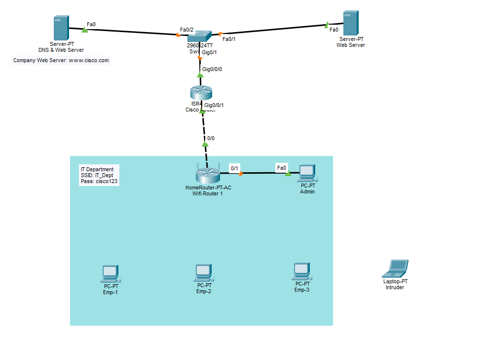
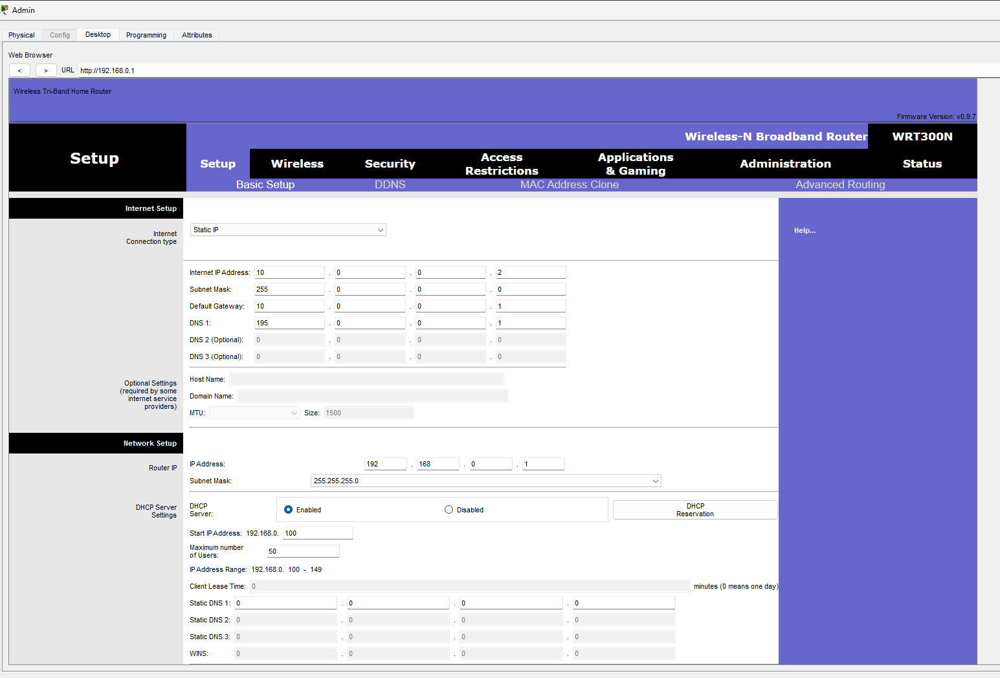
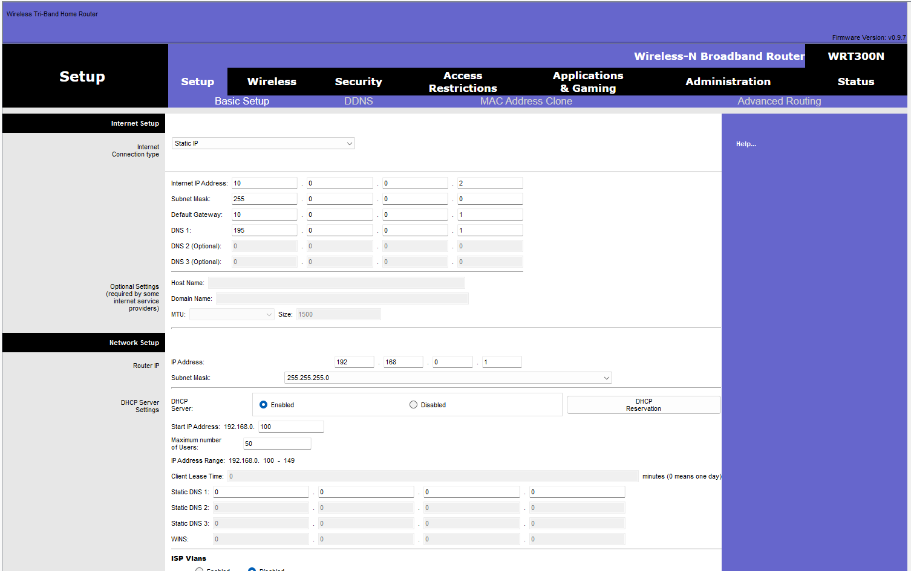
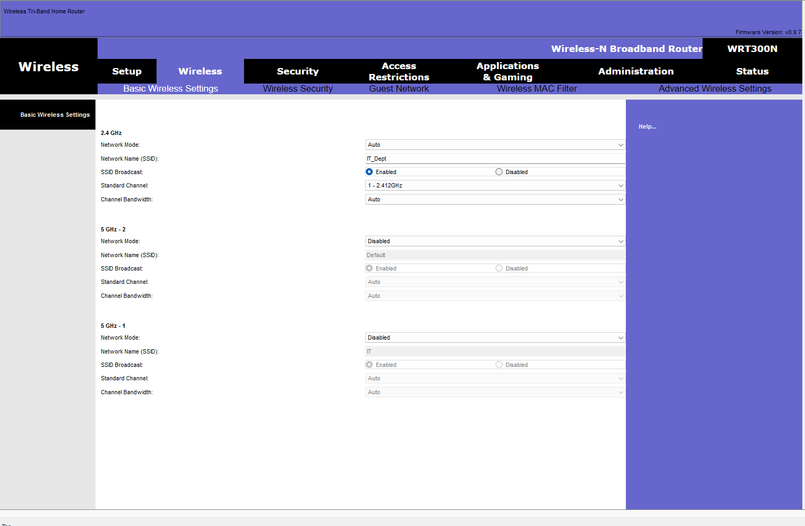
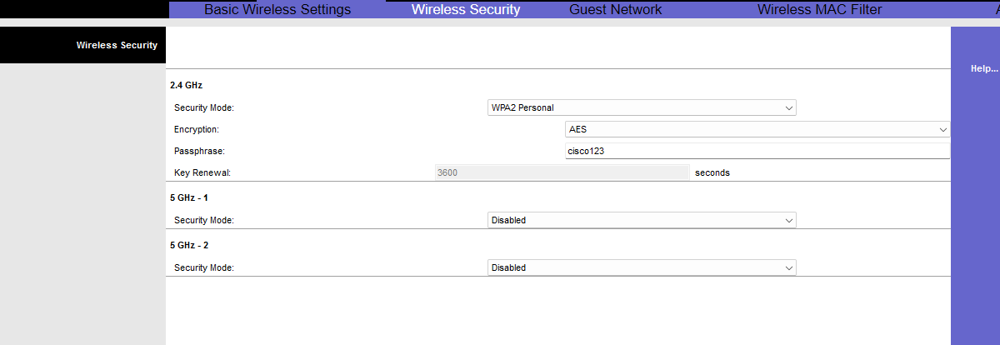
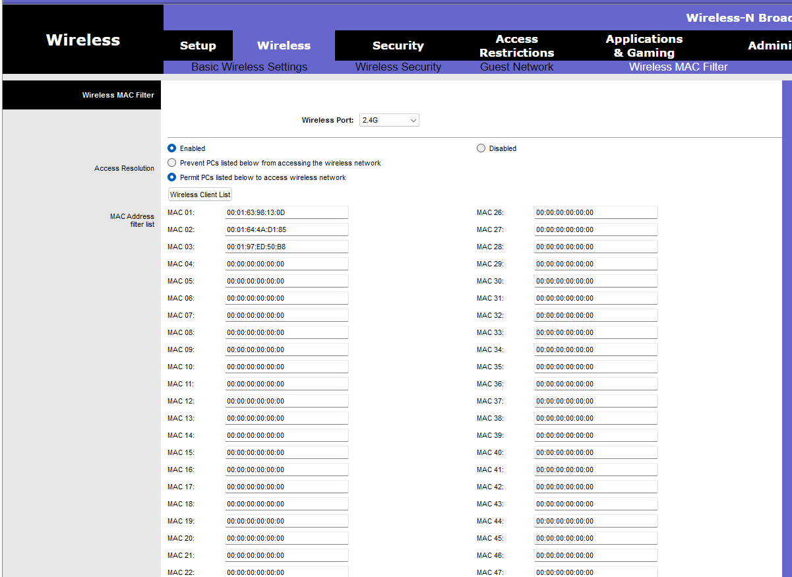
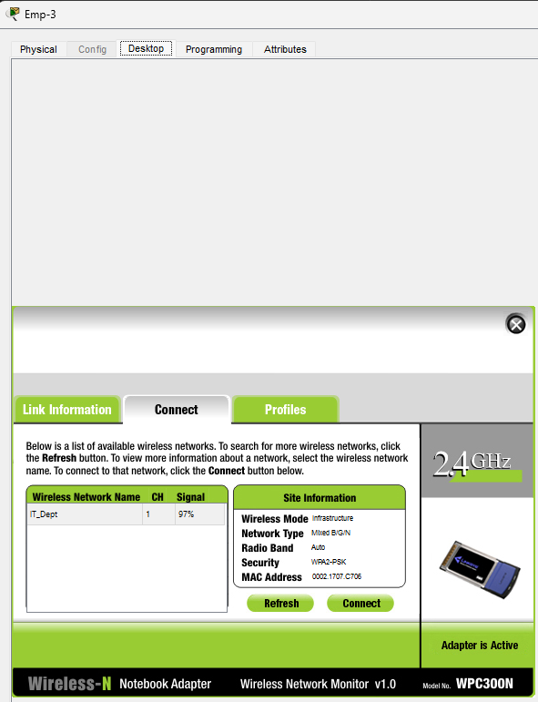
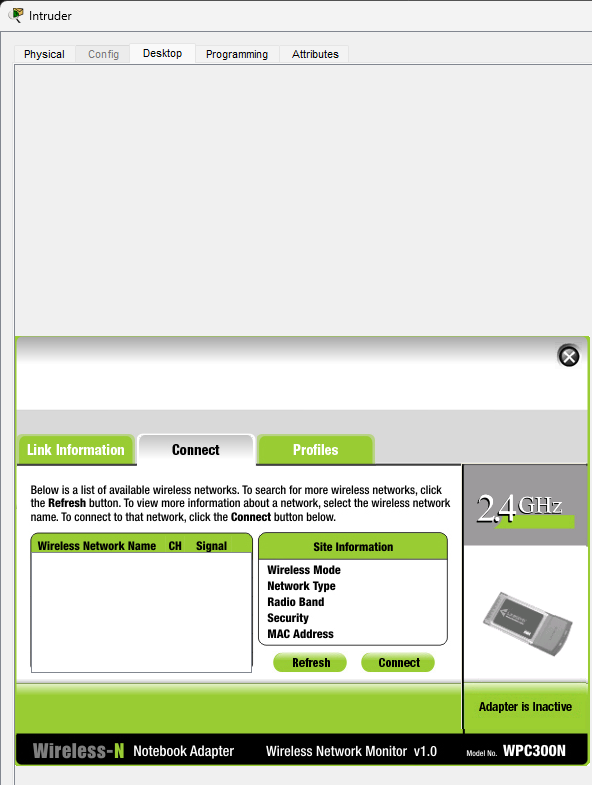
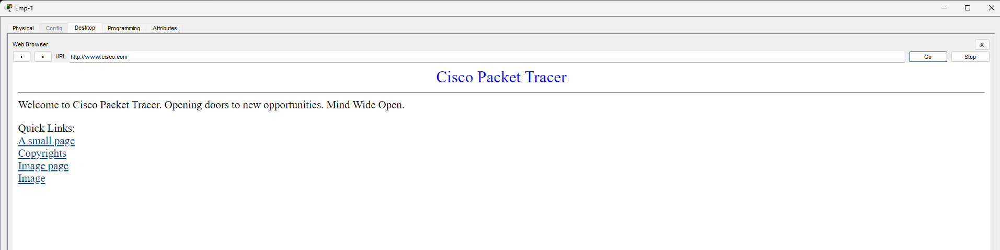
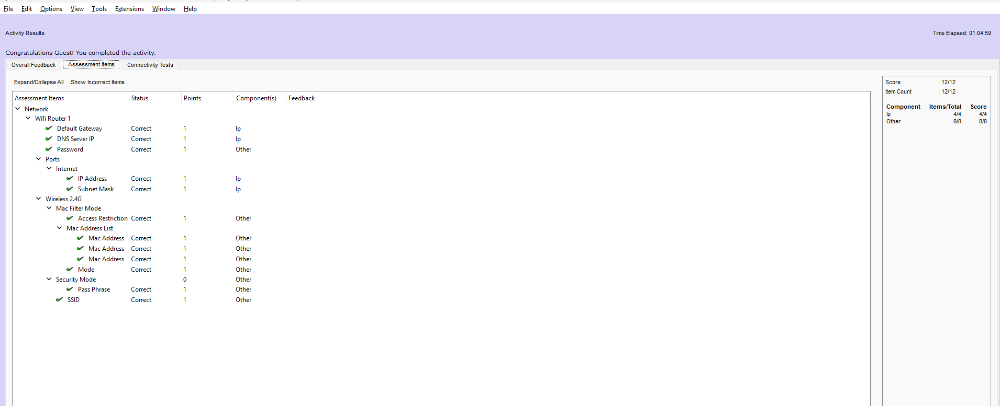

# Securing a Small Office Wireless Network (Cisco Packet Tracer)

Securing the Wi-Fi router of a fictional company, **TechNova Solutions**, after unauthorized access attempts.
**Result:** only the three employee PCs can join the network, the intruder cannot even see it, and the activity scores **12/12**.

> Final project of my 6-week summer internship on **AI, ML and Cyber Security** (MAIT × NIIT Foundation, 16 June – 31 July 2026).



## The problem

TechNova Solutions noticed people trying to get onto its Wi-Fi without permission. As the IT Administrator, I found four weaknesses in the wireless router:

1. **No usable WAN setup** – the router had no fixed address towards the company network, so wireless users could not reliably reach company services.
2. **Weak or no wireless security** – traffic could be joined or read by anyone in range.
3. **No control over which devices can join** – any laptop that knew the Wi-Fi details could connect.
4. **Default admin password** – anyone who knew the factory password could log in to the router and undo every setting.

## Devices

| Device | Model | Role |
|---|---|---|
| DNS & Web Server | Server-PT | DNS server (195.0.0.1) and company web server for `www.cisco.com` |
| Web Server | Server-PT | Second web server |
| Switch | Cisco 2960-24TT | Connects both servers to the router |
| Cisco Router | Cisco ISR | Gateway for the office network (10.0.0.1) |
| Wifi Router 1 | HomeRouter-PT-AC | The wireless router I secured (WAN 10.0.0.2, LAN 192.168.0.1) |
| Admin | PC-PT (wired) | Used to open the router's web page at `http://192.168.0.1` |
| Emp-1, Emp-2, Emp-3 | PC-PT (wireless) | Employee PCs that should have access |
| Intruder | Laptop-PT (wireless) | Unauthorized device that should be blocked |

## Configuration

All settings were made in the router's web interface, opened from the Admin PC's browser at `192.168.0.1`.



### Part 1 – WAN static IP (Setup → Basic Setup)

| Setting | Value |
|---|---|
| Internet connection type | Static IP |
| Internet IP address | 10.0.0.2 |
| Subnet mask | 255.0.0.0 |
| Default gateway | 10.0.0.1 |
| DNS 1 | 195.0.0.1 |



### Part 2 – Wireless network and encryption (Wireless → Basic Wireless Settings / Wireless Security)

| Setting | Value |
|---|---|
| Band | 2.4 GHz |
| SSID | IT_Dept |
| Security mode | WPA2-Personal |
| Encryption | AES |
| 5 GHz radios | Disabled (not needed, so less to attack) |





### Part 3 – MAC address filtering (Wireless → Wireless MAC Filter)

| Setting | Value |
|---|---|
| Wireless port | 2.4G |
| MAC filter | Enabled |
| Mode | Permit PCs listed below to access wireless network |
| Allowed devices | Emp-1, Emp-2, Emp-3 (their 3 MAC addresses only) |



### Part 4 – Router admin password (Administration → Management)

| Setting | Value |
|---|---|
| Router password | Changed from the factory default to a new password |

The new password is not written here on purpose.

## Verification

| Test | Expected | Result |
|---|---|---|
| Employee PCs connect to `IT_Dept` | Connected | ✅ Connected |
| Emp-1 opens `www.cisco.com` | Page loads | ✅ Page loads |
| Intruder scans for networks | `IT_Dept` not visible / cannot join | ✅ No networks shown |
| Packet Tracer **Check Results** | 12/12 | ✅ 12/12 |

Employee PC connected to `IT_Dept` (WPA2-PSK):



Intruder laptop – the network list is empty:



Emp-1 opening `www.cisco.com` through the secured network:



Activity check – 12/12:



## Security concepts applied

- **CIA triad**
  - *Confidentiality* – WPA2 with AES encrypts wireless traffic.
  - *Integrity* – a new admin password stops others from changing the router settings.
  - *Availability* – the correct WAN settings keep employees connected to company services.
- **Defence in depth** – several layers work together: encryption, MAC filtering and a protected admin login. If one fails, the others still help.
- **Least privilege** – only the three devices that need Wi-Fi are allowed; everything else is denied by default.

## Limitations

- **Weak passphrase** – the Wi-Fi passphrase is the short one set by the activity. A real network needs a long, random passphrase.
- **MAC spoofing** – MAC addresses can be copied, so MAC filtering alone stops casual users, not a skilled attacker.
- **Simulation only** – this was done in Packet Tracer, not on real hardware.
- **No firewall, VLANs or IDS** – there is no traffic filtering, network separation or intrusion detection.

## Future improvements

- Move to **WPA3**, or **WPA2-Enterprise with a RADIUS server** so each user has their own login.
- Use **VLANs** to separate departments and add a **guest network** for visitors.
- Add **firewall ACLs** on the router to control which traffic is allowed.
- Turn on **logging** of connections and admin logins.
- Build an **ML-based anomaly detector** that reads the connection logs and flags unusual devices or login patterns.

## How to open the project

1. Install **Cisco Packet Tracer**. It is free with a Cisco Networking Academy / Skills for All account.
2. Open Packet Tracer and sign in with that account.
3. Go to **File → Open** and choose `project/technova-secure-wireless-network.pka`.
4. Click **Check Results** in the activity window to see the 12/12 score.

> ⚠️ Do **not** click **Reset Activity** – it erases all of the configuration.

## Tools used

- Cisco Packet Tracer
- HomeRouter-PT-AC web interface (from the Admin PC's web browser)
- Packet Tracer PC Wireless tool and Web Browser for testing

## Repository layout

```
project/       Packet Tracer activity file (.pka)
screenshots/   Topology, configuration and test screenshots
```
